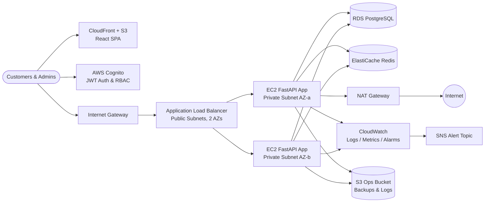
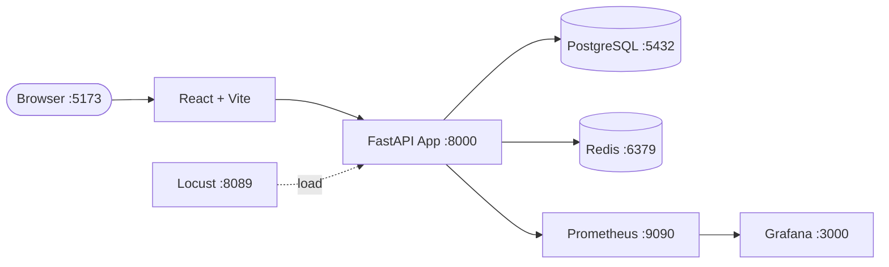
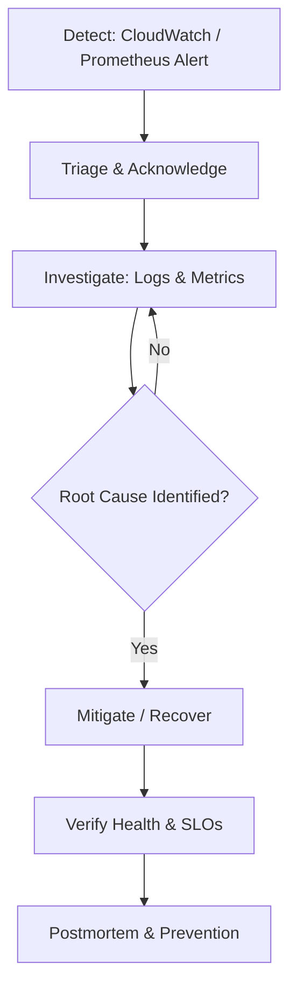

# Cloud-Native E-Commerce & SRE Platform (CCws26)

A production-style **Cloud-Native E-Commerce & Site Reliability Engineering (SRE)** platform demonstrating reliability, fault tolerance, scalability, observability, role-based security, Infrastructure as Code, performance engineering, and FinOps cost modeling on AWS.

It pairs a dual-role **React (Vite + Tailwind CSS)** frontend (Customer Storefront & Admin Portal) and a **FastAPI + PostgreSQL + Redis** backend with **AWS Cognito** RBAC, deployed on a multi-AZ AWS topology provisioned via modular **Terraform**, with **Prometheus / Grafana / CloudWatch / SNS** observability, **Locust** load testing, and documented **SLO/SLI/error-budget** targets.

---

## Project Overview

| Area | What This Project Demonstrates |
| --- | --- |
| **Reliability & Fault Tolerance** | Multi-AZ EC2 Auto Scaling Group, RDS PostgreSQL, ElastiCache Redis with graceful fallback to degraded DB-only mode, `/health` & `/ready` probes, graceful shutdown |
| **Security & RBAC** | AWS Cognito User Pool (`customer` and `admin` groups), JWT signature & claim verification in FastAPI, private subnets, least-privilege IAM & Security Groups, encryption at rest/in transit |
| **Scalability & Performance** | ALB + ASG CPU target-tracking autoscaling, rolling instance refresh, Redis response caching, DB indexes & connection pooling, Locust load testing (P50/P95/P99) |
| **Observability & Alerting** | Prometheus + Grafana locally, CloudWatch dashboards & alarms + SNS notifications in AWS, structured JSON logging with request correlation IDs |
| **User Experience** | Dual-role React SPA (Customer Storefront + Admin Management Portal) hosted via S3 + CloudFront over HTTPS |
| **Infrastructure as Code** | Modular Terraform (`auth`, `networking`, `security`, `compute`, `database`, `cache`, `storage`, `monitoring`) with S3 remote state & DynamoDB locking |
| **Incident Response & Automation** | Documented incident response workflow, safe local failure simulations, and helper automation scripts |
| **FinOps & Pricing** | Idle baseline vs. active workload cost modeling (1k / 10k / 50k users) and Price-per-User breakdown |
| **CI/CD** | GitHub Actions for linting, `pytest` unit tests, `terraform fmt/validate`, and security checks |

## Team & Responsibilities

| Member | Role | Core Ownership |
| --- | --- | --- |
| **Nithish** | Cloud Infra & Security Lead | Terraform IaC (`VPC`, `ALB`, `ASG`, `RDS`, `ElastiCache`, `S3/CloudFront`, `Cognito`), remote state bootstrap, AWS deployment & teardown |
| **Lalit** | Backend & API Engineer | FastAPI REST API, PostgreSQL schema, Redis caching & graceful fallback, Cognito JWT RBAC middleware, `pytest` suite |
| **Varun** | Frontend & UX Engineer | React Customer Storefront & Admin Management Portal, Cognito auth integration, responsive UX, S3/CloudFront frontend deployment |
| **Sid** | SRE, Performance & FinOps Lead | Prometheus, Grafana, CloudWatch/SNS alerting, Locust load testing, incident simulations, AWS pricing & Price-per-User models |

## Business Problem

A growing online retailer needs an e-commerce platform where customers can browse and purchase products reliably while administrators manage catalog inventory securely. The business requires **high availability, low latency under traffic spikes, role-isolated security, fast failure recovery, and predictable cloud costs**. This platform demonstrates how a cloud engineering and SRE team designs, automates, secures, observes, and scales such a system end to end on AWS.

## Technology Stack

AWS · Terraform · Docker / Docker Compose · Python FastAPI · React (Vite + Tailwind CSS) · PostgreSQL · Redis · AWS Cognito · Prometheus · Grafana · CloudWatch · SNS · Locust · GitHub Actions · Bash

---

## Architecture

### AWS Architecture



### Local Docker Architecture



### Cloud Provider & Service Rationale

- **AWS Managed Data Plane (RDS & ElastiCache):** Offloads patching, automated backups, and failover mechanics for stateful tiers while keeping the application tier stateless and horizontally scalable.
- **Containerized Local Parity + EC2 Auto Scaling Group:** Docker Compose ensures identical local development across all four team members, while EC2 ASG + ALB provides transparent OS-level observability, target-tracking autoscaling, and predictable cost control in AWS.
- **S3 + CloudFront for Frontend:** Decouples static SPA asset delivery from API compute, reducing backend load and improving global page latency.

### Reliability & Fault-Tolerance Design

- **Multi-AZ Compute:** Stateless FastAPI instances span 2 Availability Zones behind an ALB; ASG health checks automatically replace failed instances.
- **Health Probes:** `/health` (liveness) and `/ready` (readiness) endpoints govern ALB routing and zero-downtime rolling instance refreshes.
- **Retry & Timeout Boundaries:** Bounded database connection timeouts with retry backoff and bounded Redis socket timeouts prevent cascading thread exhaustion.
- **Graceful Redis Fallback:** If Redis becomes unavailable, the API automatically falls back to PostgreSQL in degraded mode—serving requests without user-visible `5xx` errors.
- **Graceful Shutdown:** `SIGTERM`/`SIGINT` handlers drain in-flight HTTP requests cleanly during scale-in or deployments.

---

## Infrastructure as Code

All AWS infrastructure is defined declaratively using modular **Terraform** under `terraform/`:

```text
terraform/
├── bootstrap/          # Remote state S3 bucket (versioned/encrypted) & DynamoDB lock table
├── modules/
│   ├── auth/           # AWS Cognito User Pool, App Client, customer & admin groups
│   ├── networking/     # VPC, public/private subnets across 2 AZs, IGW, NAT, route tables
│   ├── security/       # Least-privilege Security Groups & IAM instance profiles
│   ├── compute/        # Launch Template, Application Load Balancer, Auto Scaling Group
│   ├── database/       # RDS PostgreSQL subnet group & managed instance
│   ├── cache/          # ElastiCache Redis subnet group & cluster
│   ├── storage/        # S3 frontend & ops buckets + CloudFront distribution
│   └── monitoring/     # CloudWatch dashboards, metric alarms & SNS alert topic
└── environments/
    └── dev/            # Dev environment composition & backend configuration
```

### Remote State & Team Workflow

- **State Locking:** Terraform state is stored remotely in S3 with a DynamoDB lock table (created once via `terraform/bootstrap`) to prevent concurrent state corruption across the team.
- **Zero Secrets in Git:** `*.tfvars`, `*.tfstate`, `.env`, and `*.pem`/`*.key` files are strictly excluded via `.gitignore`.

### AWS Deployment & Update Steps

> **Cost Warning:** Applying Terraform provisions billable AWS resources. Always run `terraform destroy` immediately after testing or demos.

1. **Bootstrap remote state (run once per AWS account/region):**
   ```bash
   cd terraform/bootstrap
   terraform init
   terraform apply
   ```
2. **Initialize, validate, plan, and deploy the `dev` stack:**
   ```bash
   cd ../environments/dev
   terraform init
   terraform validate
   terraform plan -out=tfplan
   terraform apply tfplan
   ```
3. **Verify live endpoints:**
   - Check the ALB DNS `/health` and `/ready` endpoints.
   - Open the CloudFront URL to verify the React storefront and Cognito login flow.

---

## Security

### Authentication & Role-Based Access Control (RBAC)

Authentication is managed by **AWS Cognito**, separating users into `customer` and `admin` groups. FastAPI verifies Cognito RS256 JWT tokens against the User Pool JWKS endpoint on every protected route.

| Role / Group | Allowed Capabilities | Restricted Capabilities |
| --- | --- | --- |
| **Unauthenticated** | Browse public product catalog, view product details, health checks | Cart, checkout, order history, admin CRUD |
| **`customer`** | Browse catalog, manage cart, place orders, view own order history | Create/edit/delete catalog products, view admin analytics |
| **`admin`** | Full catalog CRUD (create, update, delete products), inventory & platform management | Enforced via Cognito `cognito:groups` JWT claim check |

### Infrastructure Security Controls

- **Network Isolation:** EC2 application instances, RDS PostgreSQL, and ElastiCache Redis reside exclusively in **private subnets**; only the ALB and CloudFront accept public ingress.
- **Least-Privilege Security Groups:** Strict security-group chaining (`ALB -> EC2 -> RDS/Redis`) with no `0.0.0.0/0` access to databases or cache.
- **IAM & Instance Hardening:** Scoped IAM instance profiles (CloudWatch + S3 ops access only), IMDSv2 enforced on EC2, and no long-lived AWS keys stored in the repository.
- **Encryption:** TLS/HTTPS in transit via CloudFront/ALB, and encryption at rest enabled for S3, EBS, RDS, and ElastiCache.

---

## Monitoring

### Metrics, Logs & Alerts

- **Application Metrics (`/metrics`):** Request volume, HTTP status codes, `5xx` error rate, P50/P95/P99 request latency histograms, DB/Redis availability gauges, cache hit/miss ratio, and in-flight requests.
- **Structured Logging:** JSON-formatted application logs with per-request correlation IDs for rapid incident tracing.
- **Local Observability (`monitoring/`):** Prometheus scrape configuration, alert rules, and pre-provisioned Grafana dashboards.
- **AWS Observability:** CloudWatch dashboards and alarms (EC2 CPU, ALB `5xx` rate, ALB target latency, unhealthy host count, RDS CPU/storage/connections) wired to an **SNS alert topic** for real-time email notifications.

### SLOs, SLIs & Error Budgets

| SLI | SLO | Target |
| --- | --- | --- |
| **Availability** | Monthly uptime | `99.9%` (~43.2 min/month error budget) |
| **Request Latency** | Requests served under `500 ms` | `99%` |
| **HTTP 5xx Error Rate** | `5xx` responses / total requests | `< 1%` |

> *Note: These values define our target SLOs. Measured results from live AWS load tests are recorded in the Scalability & Load Testing section.*

### Incident Response Workflow



**Simulated Failure Scenarios (`scripts/`):**
1. Redis cache outage (verifies graceful fallback to PostgreSQL with zero `5xx` errors).
2. High CPU / traffic spike (verifies CloudWatch alarm + ASG scale-out).
3. Unhealthy backend instance (verifies ALB deregistration + ASG automatic replacement).
4. Elevated latency / slow DB queries (verifies P95/P99 alert firing).

---

## User Experience

The frontend (`frontend/`) is a responsive **React + Vite + Tailwind CSS** Single Page Application served globally via **S3 + CloudFront**, providing two role-tailored interfaces:

- **Customer Storefront:**
  - Clean product catalog with category filtering, search, and pagination.
  - Product detail views, interactive shopping cart, and streamlined checkout flow.
  - Seamless AWS Cognito sign-up, login, and session handling.
- **Admin Management Portal:**
  - Role-gated dashboard accessible only to Cognito `admin` users.
  - Full product lifecycle controls (create, edit, restock, delete) with instant UI feedback.
  - Live system status visibility reflecting API health.

---

## Scalability & Load Testing

### Scalability & Performance Architecture

- **Horizontal Compute Scaling:** ALB distributes traffic across EC2 instances in an Auto Scaling Group configured with CPU target-tracking (`~60%` target utilization) and rolling instance refresh (`min_healthy_percentage = 50%`).
- **Caching & Query Optimization:** Redis caches high-read product listing and detail endpoints (configurable TTL), backed by PostgreSQL indexes on `category` and `name` plus SQLAlchemy connection pooling.
- **Pagination:** Bounded page sizes prevent unbounded memory growth under heavy catalog reads.

### Locust Load Testing (`load-testing/`)

Locust profiles simulate concurrent customer browsing, product detail lookups, and checkout flows against the live ALB endpoint to validate latency targets and Auto Scaling behavior.

| Test Run | Virtual Users | Spawn Rate | Throughput (RPS) | P50 Latency | P95 Latency | P99 Latency | Error Rate | ASG Instances (Start -> Peak) |
| --- | --- | --- | --- | --- | --- | --- | --- | --- |
| **Baseline** | _TBD_ | _TBD_ | _TBD_ | _TBD_ | _TBD_ | _TBD_ | _TBD_ | _TBD_ |
| **Peak Load** | _TBD_ | _TBD_ | _TBD_ | _TBD_ | _TBD_ | _TBD_ | _TBD_ | _TBD_ |
| **Redis Degraded** | _TBD_ | _TBD_ | _TBD_ | _TBD_ | _TBD_ | _TBD_ | _TBD_ | _TBD_ |

---

## Pricing

To ensure FinOps accountability, infrastructure costs are modeled across an idle baseline and three active user-traffic tiers using the AWS Pricing Calculator (Region: `eu-central-1`), including **Price-per-User** calculations.

| Scenario | Monthly Active Users (MAU) | Compute / Data Tier Sizing | Estimated Monthly Cost (USD) | Price per User (USD) |
| --- | --- | --- | --- | --- |
| **Idle Baseline** | `0` (Dev running) | 1–2x `t3.small`, `db.t3.micro`, `cache.t3.micro`, ALB, NAT, S3 | _TBD (fill from AWS Calculator)_ | — |
| **Small Workload** | `1,000` | 2x `t3.small` ASG, `db.t3.small`, `cache.t3.micro`, CloudFront | _TBD_ | _TBD_ |
| **Medium Workload** | `10,000` | 2–4x `t3.medium` ASG, `db.t3.medium` Multi-AZ, `cache.t3.small` | _TBD_ | _TBD_ |
| **High Workload** | `50,000` | 4–8x `t3.medium` ASG, `db.r6g.large` Multi-AZ, `cache.r6g.large` | _TBD_ | _TBD_ |

**Cost Optimization Practices:**
- Tear down `terraform/environments/dev` outside active testing and demo windows (`terraform destroy`).
- Offload static frontend traffic to S3 + CloudFront and hot API reads to Redis to minimize EC2 and RDS scaling costs.
- Use S3 lifecycle rules for operational logs and backups.

---

## Local Setup & Testing

**Prerequisites:** Docker & Docker Compose, Node.js (v18+), Python 3.12, Terraform (v1.6+).

```bash
# 1. Clone the repository
git clone git@github.com:nithishkodavatikanti/Cloud-Computing.git
cd Cloud-Computing

# 2. Configure local environment variables
cp .env.example .env

# 3. Start backend, PostgreSQL, Redis, Prometheus, and Grafana
docker compose up --build

# 4. Start the React frontend (in a second terminal)
cd frontend
npm install
npm run dev
```

### Verification & Test Commands

```bash
# Check API health
curl http://localhost:8000/health

# Run hermetic backend unit tests (in-memory SQLite + fake Redis)
cd app && pytest -q

# Run Locust load tests
cd load-testing && locust -f locustfile.py
```

- **Frontend (Local):** `http://localhost:5173`
- **FastAPI Docs:** `http://localhost:8000/docs`
- **Prometheus:** `http://localhost:9090`
- **Grafana:** `http://localhost:3000`

---

## Cleanup Steps

```bash
# Stop local Docker stack and remove volumes
docker compose down -v

# Destroy AWS dev environment to prevent ongoing billing
cd terraform/environments/dev
terraform destroy

# (Optional) Destroy remote state bootstrap resources only when the project is completely finished
cd ../bootstrap
terraform destroy
```

---

## Repository Structure

```text
Cloud-Computing/
├── .github/workflows/     # CI/CD workflows (lint, pytest, terraform fmt/validate)
├── app/                   # FastAPI backend, Cognito JWT RBAC, Dockerfile & tests/
├── frontend/              # React + Vite + Tailwind CSS (Customer Storefront & Admin Portal)
├── monitoring/
│   ├── prometheus/        # Prometheus scrape configs & alert rules
│   └── grafana/           # Provisioned Grafana dashboards & datasources
├── load-testing/          # Locust load-testing profiles & latency reports
├── scripts/               # Incident simulation & automation helper scripts
├── docs/screenshots/      # Live AWS UI, Grafana, CloudWatch & Locust evidence
├── terraform/
│   ├── bootstrap/         # S3 remote state bucket & DynamoDB lock table
│   ├── environments/dev/  # Dev stack composition
│   └── modules/           # auth, cache, compute, database, monitoring, networking, security, storage
├── .env.example           # Template environment variables (no real secrets)
├── .gitignore
├── LICENSE                # MIT License
└── README.md
```

---

## Screenshots & Demo Evidence

> Capture screenshots during live AWS deployment and save them in `docs/screenshots/`.

- [ ] Customer Storefront & Admin Management Portal (CloudFront HTTPS)
- [ ] AWS Cognito User Pool & Role-Based Access Enforcement
- [ ] Grafana Overview Dashboard & Prometheus Alert Firing
- [ ] AWS CloudWatch Dashboard & SNS Alert Notification
- [ ] Locust Load-Test Report & EC2 Auto Scaling Group Scale-Out

---

## Future Improvements

- Automated blue/green or canary deployments via CodeDeploy and ALB weighted target groups.
- Terraform drift detection and PR cost-estimation comments via Infracost.
- RDS Proxy for high-concurrency database connection pooling and read replicas.
- Distributed tracing with OpenTelemetry alongside metrics and structured logs.
- Automated chaos engineering drills using AWS Fault Injection Service (FIS).
